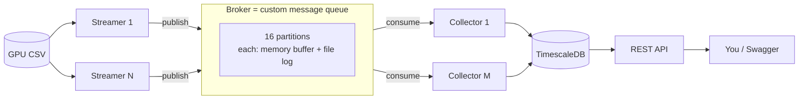
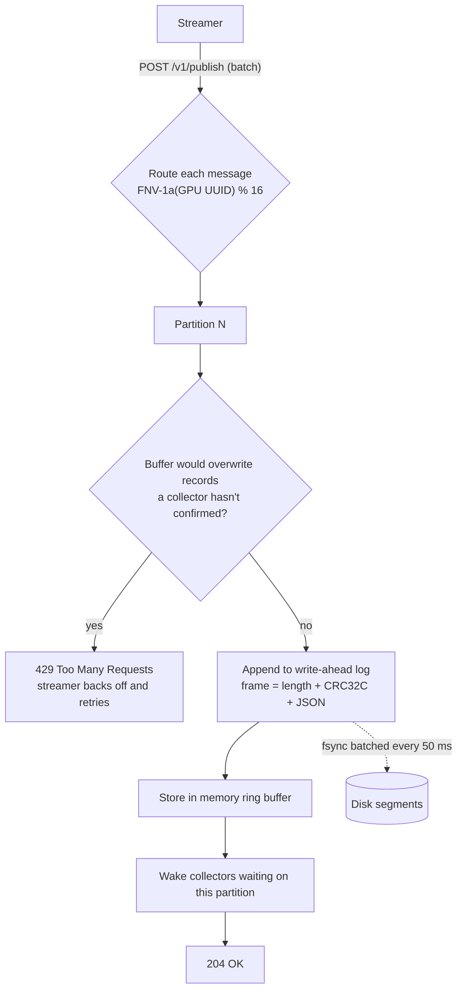
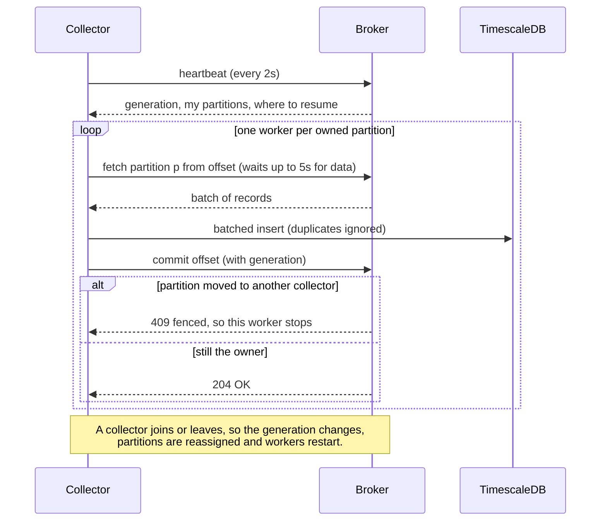
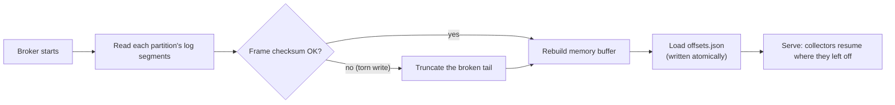

# Elastic GPU Telemetry Pipeline

A small, scalable pipeline that streams GPU telemetry from a CSV, carries it
through a **custom message queue** (no Kafka / RabbitMQ / ZeroMQ), stores it in
TimescaleDB, and serves it over a REST API. Written in Go, runs with one command
on Docker, and ships with Helm charts for Kubernetes.

The full design (requirements, queue internals, failure handling, trade-offs) is
in **[docs/HLD.md](docs/HLD.md)**.

---

## Quick start

**You only need Docker.** Everything else (Go, the database, tooling) runs in
containers. From this folder:

```bash
make demo        # build, start everything, and verify it works
```

Then:

```bash
curl localhost:8080/api/v1/gpus                 # list GPUs
open http://localhost:8080/swagger/index.html   # interactive API docs
```

No `make`? Use `./run.sh` instead. Stop everything with `make down` (or
`./run.sh down`).

---

## What it does

The sample data is a DCGM export: 2,470 rows covering **31 hosts, 247 GPUs
(H100), 10 metrics** (GPU utilisation, temperature, power, memory, clocks…).
The pipeline replays that CSV in a loop to act like a live telemetry feed, and
**stamps each reading with the time it was processed** (`time.Now()`), as the
task requires.

---

## Architecture



**Flow of one reading:** a streamer reads a CSV row → tags it with the current
time → publishes it to the broker with the GPU's UUID as the key → the broker
stores it in the partition for that UUID → a collector pulls it and writes it to
TimescaleDB → the API serves it.

### The components

- **Streamer** — reads the CSV on a loop and publishes rows. Multiple streamers
  **split the GPUs between themselves** (each owns a share), so adding streamers
  adds throughput instead of duplicating data.
- **Broker (the custom queue)** — the heart of the project. Receives messages,
  stores them, and hands them to collectors. Explained below.
- **Collector** — pulls messages from the broker, parses them, and writes them to
  the database in batches. Multiple collectors share the work automatically.
- **API** — a REST service to list GPUs and query their telemetry. Its OpenAPI
  spec is generated from the code.
- **TimescaleDB** — the database (a time-series flavour of PostgreSQL).

---

## How the message queue was built

The task says: build your own queue, don't use an existing one. So the broker is
written from scratch (`internal/mq`). It borrows the proven ideas from Kafka but
in a few hundred lines of Go. The transport is plain HTTP/JSON — only the pipe;
all the queue logic is ours.

Key ideas:

- **Partitions.** The topic is split into 16 partitions. A message's key (the GPU
  UUID) decides its partition, so all readings for one GPU stay in order.
- **Durable log.** Each partition is an append-only file on disk (a
  write-ahead log) with a recent-messages buffer in memory for speed. If the
  broker restarts, it replays the files and loses nothing it had acknowledged. A
  half-written record from a crash is detected (checksum) and trimmed.
- **Consumer groups.** Collectors join a group; the broker splits the 16
  partitions across them. If a collector joins or dies, the broker rebalances the
  partitions to the others — no restart needed.
- **At-least-once + no duplicates.** A collector only confirms a message after
  the database write succeeds. If it retries, the database ignores the duplicate
  thanks to a unique key `(gpu, time, metric)`. So nothing is lost and nothing is
  double-stored.
- **Backpressure.** Each partition is bounded. If collectors fall behind, the
  broker tells streamers to slow down instead of running out of memory.
- **Fencing.** When partitions move during a rebalance, an out-of-date collector
  can't overwrite the new owner's progress (its commit is rejected).

### Design flow

**1. Writing a message (publish).** The key picks the partition; the record is
appended to the log file first, then to the memory buffer, then waiting
collectors are woken up.



**2. Reading a message (consume and commit).** A collector learns which
partitions it owns from its heartbeat, long-polls them, writes to the database,
and only then confirms (commits) the offset.



**3. Recovering after a crash.** On startup the broker rebuilds every partition
from its log files and resumes each group from its last saved offset.



### Scaling: any number of streamers and collectors

Streamers and collectors scale **independently**. Any mix works (2 and 3, 6 and
5, 1 and 10, and so on), with no code or config change.

- **Streamers split the GPUs.** Each one gets a slot (index of count) from the
  broker and publishes only its own GPUs, so no GPU is sent twice.
- **Collectors split the 16 partitions.** The broker spreads them round-robin,
  so each partition has exactly one collector.
- **Rebalancing is automatic.** Scale up or down while it's running; within a
  few seconds the broker reassigns the work, and nothing restarts.

```bash
make scale STREAMERS=2 COLLECTORS=3     # any numbers you like
make scale STREAMERS=6 COLLECTORS=5
make scale STREAMERS=1 COLLECTORS=10    # one streamer, many collectors
make scale STREAMERS=10 COLLECTORS=1    # many streamers, one collector
```

Example: with 6 streamers and 5 collectors (tested live), each streamer owned
one sixth of the GPUs, and the collectors split the partitions like this:

| Collector | Partitions |
|---|---|
| 1 | 0, 5, 10, 15 |
| 2 | 1, 6, 11 |
| 3 | 2, 7, 12 |
| 4 | 3, 8, 13 |
| 5 | 4, 9, 14 |

To see the assignment yourself:

```bash
docker compose logs streamer  | grep "shard assigned"
docker compose logs collector | grep "partitions assigned"
```

**Limit:** there are 16 partitions, so up to 16 collectors can have work; any
beyond that sit idle. The brief caps both at 10, so every collector always gets
work. Streamers have no such limit.

---

## Why TimescaleDB

The reads are always "one GPU, a time range, in time order" and the writes are a
constant append of new readings — classic time-series. TimescaleDB fits this:

- It's just PostgreSQL, so standard SQL, a solid Go driver, and easy to run.
- Time-based tables keep range queries fast as data grows.
- A unique key gives us free de-duplication for the queue's retries.
- Built-in data retention keeps a forever-looping stream from filling the disk.

(InfluxDB, ClickHouse, Cassandra were considered — heavier or weaker fits for
simple per-GPU lookups. Plain Postgres would work but we'd hand-build the
time-series parts.)

---

## REST API

Base URL `http://localhost:8080`. Full, interactive docs at `/swagger/index.html`.

| Endpoint | What it returns |
|---|---|
| `GET /api/v1/gpus` | All GPUs that have telemetry |
| `GET /api/v1/gpus/{uuid}/telemetry` | One GPU's telemetry, ordered by time |

`{uuid}` is the GPU UUID (e.g. `GPU-a20b4d58-…`), because the small `gpu_id`
(0–7) repeats on every host. Optional filters on the telemetry endpoint:

- `start_time`, `end_time` — RFC 3339, inclusive
- `metric` — e.g. `DCGM_FI_DEV_GPU_TEMP`
- `limit` (1–10000) and `cursor` — for paging through large results

Health probes: `/healthz`, `/readyz`.

---

## Sample workflow

```bash
# Pick a GPU
GPU=$(curl -s localhost:8080/api/v1/gpus | jq -r '.items[0].uuid')

# Its telemetry, newest window, one metric
curl -s "localhost:8080/api/v1/gpus/$GPU/telemetry?metric=DCGM_FI_DEV_GPU_TEMP&limit=5" | jq

# A time range (inclusive)
curl -s "localhost:8080/api/v1/gpus/$GPU/telemetry?start_time=2026-10-24T18:00:00Z&end_time=2026-10-25T00:00:00Z" | jq '.items | length'
```

---

## Build, test, and deploy

```bash
make demo        # build + start + verify (first-time users)
make up          # just start the stack
make scale STREAMERS=1 COLLECTORS=5   # rescale live
make down        # stop and wipe

make test        # unit tests + system test (race detector)
make coverage    # coverage summary + coverage.html (~76%)
make openapi     # regenerate the OpenAPI spec from code
make help        # all targets
```

**Packaging:** one small distroless Docker image holds all four binaries
(`Dockerfile`), each started with its own command. It runs as a non-root user
with a read-only filesystem.

**Kubernetes (Helm):**

```bash
kind create cluster
make kind-load helm-install          # build, load image, install chart
kubectl get pods
kubectl port-forward svc/gpu-telemetry-api 8080:8080
kubectl scale deploy/gpu-telemetry-collector --replicas=5   # scale live
```

The chart (`deploy/helm/gpu-telemetry`) runs the broker and database as
StatefulSets with disk, the streamer/collector/API as Deployments, generates a
random DB password into a Secret, and locks down traffic with NetworkPolicies.
No passwords are ever hardcoded.

---

## Testing

- **Unit tests** for the tricky parts: queue crash-recovery, backpressure,
  duplicate protection, lease/rebalance logic, CSV parsing, API errors.
- **System test** (bonus) in `test/e2e/`: runs the whole pipeline in-process over
  the real CSV with 2 streamers and 2 collectors, and checks all 247 GPUs arrive.
- **`scripts/smoke_test.sh`**: 13 checks against the running Docker stack.

Run them all with `make test`.

---

## Project layout

A file-by-file guide is in **[docs/PROJECT_STRUCTURE.md](docs/PROJECT_STRUCTURE.md)**.

```
cmd/{broker,streamer,collector,api}   the four services (just startup wiring)
internal/mq        the custom message queue (log, partitions, groups, client)
internal/telemetry CSV reader + data model
internal/streamer  sharded CSV replay
internal/collector queue → database
internal/store     database layer (TimescaleDB + in-memory for tests)
internal/api       REST handlers + OpenAPI annotations
deploy/helm/       Helm chart
docs/              design docs (HLD, AI usage, structure) + generated OpenAPI spec
data/              sample DCGM telemetry CSV
test/e2e/          system test
scripts/           live smoke test
.github/workflows/ CI: vet, race tests, Helm lint, Docker build
```

---

## How AI was used

This project was built with the Cursor AI agent and reviewed by me. I made the
design decisions; AI wrote most of the code and helped debug. A detailed,
prompt-by-prompt writeup (repo bootstrap, code bootstrap, tests, build env, and
where AI got things wrong) is in **[docs/AI_USAGE.md](docs/AI_USAGE.md)**.
