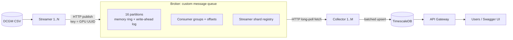
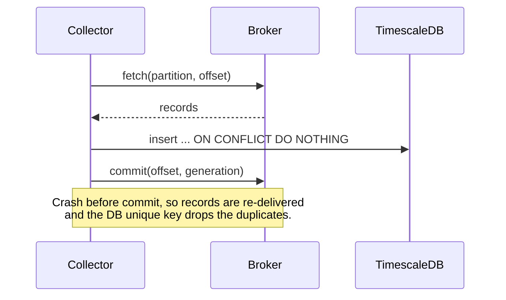

# High-Level Design: Elastic GPU Telemetry Pipeline

This is the design I worked out before writing any code. Once the design was
settled, I used AI (Cursor) to help write the code against it. How I used AI is
covered in [AI_USAGE.md](AI_USAGE.md).

---

## 1. Problem

GPU telemetry (DCGM metrics in a CSV) has to flow through a pipeline into a
store that users can query over a REST API. The pipeline must be built around
**my own message queue** (no Kafka, RabbitMQ, ZeroMQ), and the producers and
consumers must scale independently.

## 2. Requirements

**Functional**

- A **Streamer** reads the CSV in a loop and publishes each row as a telemetry
  message. The timestamp is the **processing time** (`time.Now()`), not the time
  in the CSV.
- A **custom message queue** sits between streamers and collectors.
- A **Collector** consumes messages, parses them, and persists them.
- An **API Gateway** exposes:
  - `GET /api/v1/gpus`: list all GPUs that have telemetry.
  - `GET /api/v1/gpus/{id}/telemetry`: telemetry for one GPU, ordered by time,
    with optional `start_time` / `end_time` filters.
- The OpenAPI spec is generated from the code.

**Non-functional**

- Streamers and collectors scale up and down independently (1 to 10 each),
  both 1 streamer to N collectors and N streamers to 1 collector.
- No data loss on a broker restart; no duplicate rows in the database.
- Runs with one command locally (Docker) and on Kubernetes (Helm).
- Secure deployment defaults: no hard-coded secrets, non-root containers,
  restricted network access. (TLS and authentication between services are
  future work.)

## 3. What the data told me

Before designing, I looked at the CSV (2,470 rows, 31 hosts, 10 metrics):

- `gpu_id` is just `0–7` and **repeats on every host**, so it cannot identify a
  GPU. The **GPU UUID** is unique (247 GPUs), so I use it as the ID everywhere:
  the queue key, the database key, and the API path.
- Every row is one metric for one GPU, so the natural unique key for a reading is
  **(GPU UUID, timestamp, metric)**.

## 4. Architecture



Every service is stateless except the **broker** (its log on disk) and
**TimescaleDB**. That's what lets streamers, collectors and API replicas scale
freely.

## 5. Components

| Component | Responsibility | Scales by |
|---|---|---|
| Streamer | Read CSV, stamp `time.Now()`, publish its share of GPUs | Adding replicas (GPUs re-shard automatically) |
| Broker | Store messages durably, hand partitions to collectors, track progress | Partitions (single node for now) |
| Collector | Fetch, validate, batch-write to the DB, then commit | Adding replicas (partitions rebalance automatically) |
| TimescaleDB | Store time-series telemetry, serve queries | Vertical size / chunking |
| API Gateway | REST queries, pagination, OpenAPI | Adding replicas (stateless) |

## 6. Message queue design

I modelled the queue on the ideas that make Kafka reliable, kept small enough
to build and explain.

### 6.1 Partitioning and ordering

- One topic, **16 partitions**.
- Partition = `FNV-1a(GPU UUID) % 16`, so every reading for a GPU lands in the
  same partition and **stays in order**.
- 16 partitions is more than the maximum of 10 collectors, so every collector
  always gets work.

### 6.2 Storage: a durable log per partition

- Each partition is an **append-only write-ahead log** split into segment files,
  plus a **bounded in-memory ring buffer** that serves reads quickly.
- Record frame on disk: `[length][CRC32C][JSON]`. The checksum lets recovery
  detect a half-written record after a crash and trim it.
- Disk syncs (`fsync`) are **batched every 50 ms** for throughput.
- Old segments are deleted once their records have left the ring buffer.

### 6.3 Consumer groups and rebalancing

- Collectors join a **consumer group** and send a heartbeat every 2 s. A member
  whose lease (6 s) expires is removed.
- Any change in membership bumps the group's **generation**, and partitions are
  reassigned **round-robin** across the live members.
- Each collector runs **one worker per partition it owns**. On a rebalance it
  stops all workers, then starts new ones for its new partitions.

### 6.4 Delivery guarantee: at-least-once, stored exactly once



- A collector commits **only after** the database write succeeds, so nothing is
  lost.
- Re-delivery is possible, so the table has `UNIQUE (gpu_uuid, ts, metric)`
  and writes use `ON CONFLICT DO NOTHING`. The result is **no duplicates**.
- **Fencing:** a commit carries the generation. If the partition has moved to
  another collector, the commit is rejected (409) and the old worker stops, so a
  stale collector can never overwrite the new owner's progress.

### 6.5 Backpressure

- The ring buffer is bounded (10,000 records per partition).
- If accepting a publish would overwrite records a group hasn't committed yet,
  the broker returns **429** and the streamer backs off and retries. Memory stays
  bounded and unread data is never dropped.

### 6.6 Transport

- Plain **HTTP/JSON**. It is only the pipe; all the queue logic is my own.
- Fetch is a **long-poll**: the request waits up to a few seconds for new data
  instead of busy-polling.
- Request bodies are size-limited and names are validated.

## 7. Streamer sharding

Streamers **split** the GPUs between them rather than each publishing
everything, so adding streamers adds throughput without duplicating data.

- Each streamer heartbeats to a **shard registry** on the broker and gets back
  `(index, count)`.
- A streamer publishes a row only if `FNV-1a(GPU UUID) % count == index`.
- When a streamer joins or leaves, the count changes and the GPUs re-shard
  automatically.

## 8. Data model (TimescaleDB)

```sql
gpus      (uuid PK, gpu_id, device, model_name, hostname, last_seen)
telemetry (ts, gpu_uuid, metric, value, labels JSONB,
           UNIQUE (gpu_uuid, ts, metric))   -- hypertable on ts
```

- `telemetry` is a **hypertable** with 1-hour chunks, a 7-day retention policy,
  and **columnar compression** for chunks older than 2 hours (segmented by GPU,
  ordered by time).
- Writes are **batched**: one round trip per batch using `unnest` arrays.
- GPU rows are upserted in sorted order so concurrent collectors can't deadlock.

**Why TimescaleDB:** the data is time-series and the main query is "one GPU,
over a time window, ordered by time". TimescaleDB is PostgreSQL, so I get SQL,
transactions and unique constraints (for deduplication), plus time-partitioned
chunks and retention built in. A pure TSDB such as InfluxDB lacks easy
unique-key deduplication. A plain NoSQL store would need hand-built time
indexing.

## 9. API design

- `GET /api/v1/gpus` returns every GPU (UUID, gpu_id, host, model, last seen).
- `GET /api/v1/gpus/{uuid}/telemetry?start_time=&end_time=&metric=&limit=&cursor=`
  - Time bounds are RFC 3339 and **inclusive**.
  - Results are ordered by `(timestamp, metric)`.
  - **Keyset pagination:** the response returns `next_cursor` (an opaque token
    for the last row). This stays fast on large tables, unlike `OFFSET`.
  - `limit` defaults to 1,000 (maximum 10,000).
- Errors return a JSON body: 400 for bad input, 404 for an unknown GPU, 500 for
  internal errors (details are never leaked).
- `/healthz` (liveness) and `/readyz` (database reachable) are available for
  Kubernetes probes.
- The OpenAPI spec is generated from code annotations (`make openapi`) and
  served at `/swagger/`.

## 10. Scale, performance and availability

The brief caps streamers and collectors at **10 instances each**. I sized the
design around that limit and checked it with numbers measured on the running
system (Docker, 6 streamers and 5 collectors).

### 10.1 Load model

- The CSV has 2,470 rows. Each pass over it takes about 1 s (`STREAM_INTERVAL`),
  so the pipeline carries about **2,400 messages/s** (measured: 2,388 rows/s
  written to the database).
- Streamers **split** the GPUs, so the total rate stays the same as streamers
  are added; each streamer just does less. At 10 streamers that is about 240
  msg/s each, and at 10 collectors about 240 rows/s each.
- 16 partitions is more than the 10-collector cap, so every collector always
  has work, with at most a 2-to-1 imbalance (2 partitions vs 1).

### 10.2 Measured headroom

| Component | Memory | CPU | Notes |
|---|---|---|---|
| Streamer (each) | ~15 MiB | ~1% | Stateless |
| Collector (each) | ~15 MiB | ~1.5% | Stateless |
| Broker | ~240 MiB | ~5% | Ring buffers: 16 × 10,000 × ~450 B ≈ 72 MB |
| TimescaleDB | ~2.3 GiB | ~8% | Single node |
| API | ~11 MiB | ~0% | Stateless |

Every component is far from saturation at the 10-instance cap. The first limits
would be the single broker and the single database, not the workers.

### 10.3 Performance choices

- **Batching everywhere:** streamers publish 500 rows per request, collectors
  fetch 1,000 records, and the database insert is one round trip per batch
  (`unnest` arrays).
- **Long-poll fetch:** collectors wait on the broker for new data instead of
  busy-polling.
- **Batched fsync:** the write-ahead log is synced every 50 ms, not per message.
- **No global lock:** each partition has its own lock, so publishes to
  different partitions never block each other.
- **Fast reads:** the unique index `(gpu_uuid, ts, metric)` matches the API
  query exactly; keyset pagination never scans skipped rows; compressed chunks
  are segmented by GPU. A query 10 hours back returned in about 0.2 s.

### 10.4 Buffering and backpressure

- The broker buffers up to 16 × 10,000 = **160,000 records**, which is about
  **65 s** of traffic. If the collectors or the database stall for longer than
  that, the broker returns 429 and the streamers slow down instead of the broker
  running out of memory or dropping unread data.

### 10.5 Storage

- The rate is about 207 million rows/day. Uncompressed, rows take about 610 B
  each (including indexes): **about 125 GB/day**. That is too much, as I found
  after 10 hours of running at 55 GB.
- I enabled TimescaleDB compression for chunks older than 2 hours. Measured
  ratio: **74 to 1** (11 GB down to 147 MB).
- Steady state is about 12 GB for 7 days of compressed data plus about 15 GB
  for the newest few uncompressed hours. The Helm chart requests a 50 Gi volume.

### 10.6 Availability

| Component | Instances | If one fails | Recovery |
|---|---|---|---|
| Streamer | 1–10 (stateless) | Its GPUs aren't published until its lease expires | ≤ 6 s; the others take over its shard |
| Collector | 1–10 (stateless) | Its uncommitted batch is re-delivered (and deduplicated) | ≤ 6 s; partitions move to the others |
| API | 2+ (stateless) | Readiness probe removes it from the service | Immediate; the other replicas serve |
| Broker | 1 + persistent volume | Streamers retry with backoff; collectors wait | Pod restart + log replay (seconds); no committed progress lost |
| TimescaleDB | 1 + persistent volume | Collectors retry and don't commit; the broker buffers ~65 s, then backpressure; API reports not ready | Pod restart; nothing lost |

- Graceful shutdown (rolling updates, scale-down) makes members **leave**
  explicitly, so rebalancing is immediate rather than waiting for the lease.
- **Known single points of failure:** the broker and the database (one replica
  each). A broker *process* crash loses nothing, because written data is already
  in the OS page cache. A full *node* power loss could lose up to the last 50 ms
  of writes not yet synced. The fix for both is replication (see future work).
- **Known limitation, streamer rescale window:** streamers learn the new share
  count independently, one heartbeat at a time. For up to one heartbeat interval
  (2 s) after a streamer joins or leaves, a GPU can be published twice or
  skipped. Because each copy gets its own `time.Now()`, the database won't
  deduplicate these. For telemetry, a 2-second blip during a rescale is
  acceptable. A strict fix would need an epoch-fenced handoff between streamers.
- **Known limitation, abandoned consumer groups:** backpressure uses the slowest
  group's offset, and groups are never deleted. A group that is created once and
  then abandoned would eventually block producers. This deployment uses a single
  group (`collectors`); group expiry would be needed before allowing ad-hoc
  consumers.

### 10.7 Scaling scenarios

| Scenario | What happens |
|---|---|
| 1 streamer, many collectors | The streamer owns all GPUs and fills all 16 partitions; collectors split the partitions |
| Many streamers, 1 collector | Streamers split the GPUs; the single collector owns all 16 partitions |
| Any mix (e.g. 2 and 3, or 6 and 5) | Streamers split the GPUs, and collectors split the partitions; in steady state each GPU and partition has exactly one owner |
| Scale up or down at runtime | Heartbeats detect the change; shards and partitions rebalance with no restart |

Up to 16 collectors can have work (one per partition); any beyond that sit idle.
Streamers have no limit. With 6 streamers and 5 collectors (tested live), the
collectors owned 4, 3, 3, 3 and 3 partitions.

## 11. Failure handling

| Failure | Handling |
|---|---|
| Broker restarts | Replays the log, trims torn records, reloads offsets (written atomically); collectors resume |
| Collector dies | Its lease expires (6 s), and its partitions move to the other collectors |
| Streamer dies | Its lease expires, and the remaining streamers take over its GPUs |
| Database down | Collector retries with backoff and doesn't commit, so no data is lost |
| Collectors too slow | Broker returns 429, and streamers slow down (backpressure) |
| Bad CSV row or bad message | Logged and skipped, so one bad record can't stall a partition |
| Invalid request | Fails fast (4xx is not retried); temporary errors are retried with jittered backoff |
| Graceful shutdown | Streamers and collectors leave their group, so rebalancing is immediate |

## 12. Security

- No secrets in code or images. The database password comes from a generated
  `.env` (Docker) or a generated Kubernetes Secret (Helm).
- **Distroless, non-root** images (uid 65532) with a read-only root filesystem.
- Kubernetes **NetworkPolicies**: only collectors and the API can reach the
  database, and only the pipeline services can reach the broker.
- Input validation on every endpoint: body size limits, name patterns, and
  parameter bounds.
- HTTP server timeouts against slow clients; panic recovery and `nosniff`
  headers on the API.

## 13. Deployment

- **Docker Compose** for local runs. `make demo` starts the stack and runs a
  smoke test, and `make scale STREAMERS=2 COLLECTORS=3` scales it.
- **Helm chart** for Kubernetes: the broker and TimescaleDB as StatefulSets
  with persistent volumes, and streamers, collectors and the API as Deployments.
  Replica counts are configurable.
- One multi-stage Dockerfile builds all four binaries.

## 14. Key decisions and trade-offs

| Decision | Why | Trade-off |
|---|---|---|
| Shard GPUs across streamers | Scaling adds throughput, with no duplicate data | Needs a small shard registry |
| Single broker with a write-ahead log | Simple, durable, easy to reason about | Broker is a single point of failure (see future work) |
| GPU UUID as the key | `gpu_id` repeats per host | UUIDs are long in URLs |
| At-least-once delivery + DB unique key | Simpler than exactly-once; the outcome is equivalent | Some re-delivery on failure |
| HTTP/JSON instead of gRPC | Easy to debug with curl, no code generation | Slightly more overhead |
| TimescaleDB | SQL + deduplication + time-series features | Heavier than an embedded store |
| Keyset pagination | Stable and fast on large tables | Can't jump to page N |
| Compress chunks older than 2 h | 74× less disk | Late re-deliveries into compressed chunks are slower |
| fsync every 50 ms, not per message | Much higher write throughput | Node power loss can drop the last ≤ 50 ms |

## 15. Future work

- **Broker replication** (a leader and followers per partition) to remove the
  single point of failure.
- **Database high availability**: a streaming replica with automatic failover
  (for example Patroni), plus read replicas for the API.
- **PodDisruptionBudgets and anti-affinity**, so node maintenance never takes
  down all streamers or collectors at once.
- **TLS and authentication** between services and on the public API.
- **Prometheus metrics**: consumer lag per partition, publish rate, 429 count.
- Changing the partition count without downtime.

## 16. How I implemented it

I made the design and the key decisions above: sharding the streamers, the
single durable broker, the partition and consumer-group model, at-least-once
delivery with database deduplication, and TimescaleDB. I then used AI to write
the code against this design, reviewed and tested every part, and fixed the
issues we found. The full split, with the prompts I used, is in
[AI_USAGE.md](AI_USAGE.md).
